<div align="center">


**A role-playing game for real networking.**
Roll a fictional character, meet other players, quest through the network to reach anyone, and take the mask off only when you both choose to.

<br/>

[](https://fishnet-0crx.onrender.com)


</div>

## The idea

Networking rewards a polished self, and most people never walk up to the stranger. **FishNet makes the first move cheap.** You start as an absurd fictional character (a billionaire founder, a venture capitalist, an AI research leader) and everything social happens between characters. Your real name, role, bio and LinkedIn stay locked until you and a connection **both** press reveal.

> *The persona was fictional. The connection is real.*

<div align="center">
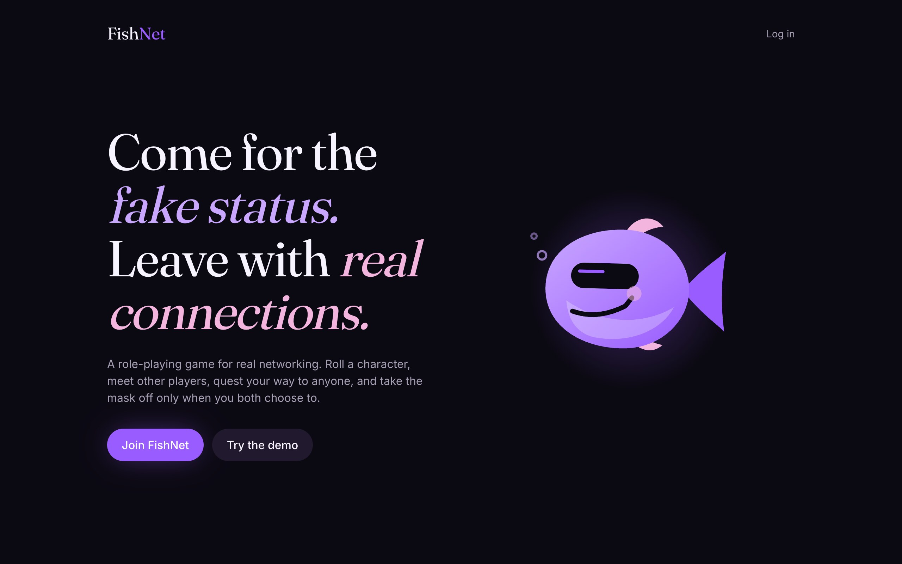
</div>

<br/>

## The game loop

| | Stage | What happens |
|---|---|---|
| 🎭 | **Character creation** | Pick a class, roll a fictional name, company and valuation, re-roll until it feels right. Always labelled *fictional*. |
| 💫 | **Encounters** | Swipe through other characters, ranked by a transparent relevance score. A connection forms only when **both** people like each other. |
| 🗺️ | **Quest map** | Your network is an interactive graph. Pick anyone and the shortest route through *confirmed* connections lights up. |
| 🧭 | **Start quest** | Walk the route one step at a time. Message each stop, ask the previous stop to introduce the next, and finish with a real connection. |
| 💬 | **Masked chat** | Talk behind the mask, with icebreakers generated from your shared interests. |
| 🥁 | **Mask off** | When you both choose, a drum roll, a burst, and the persona card flips into a real, consented identity. |

<table>
<tr>
<td width="50%">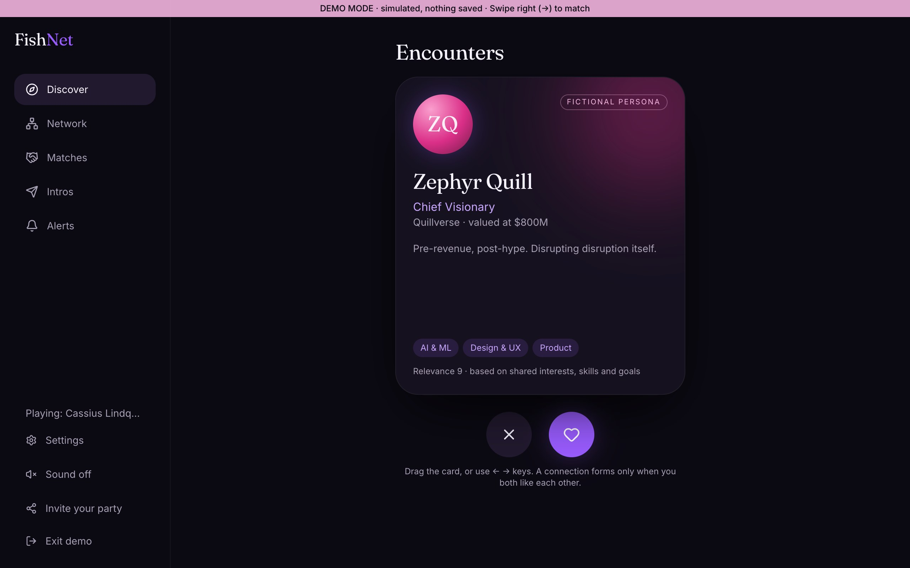<br/><sub><b>Encounters.</b> Drag, tap or use the arrow keys.</sub></td>
<td width="50%">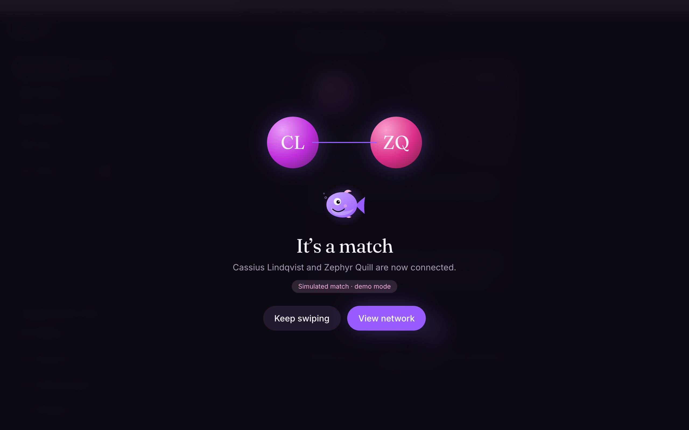<br/><sub><b>It's a match.</b> Only when both people say yes.</sub></td>
</tr>
<tr>
<td width="50%">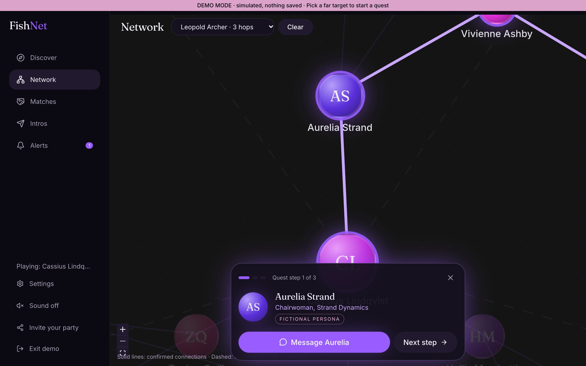<br/><sub><b>Quest walk.</b> The route glows, the camera follows.</sub></td>
<td width="50%">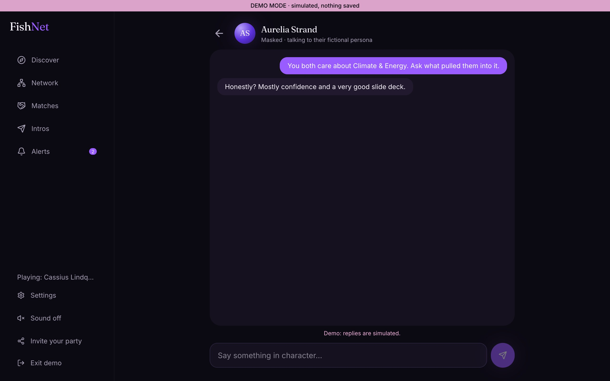<br/><sub><b>Masked chat.</b> Starters from your shared interests.</sub></td>
</tr>
<tr>
<td width="50%">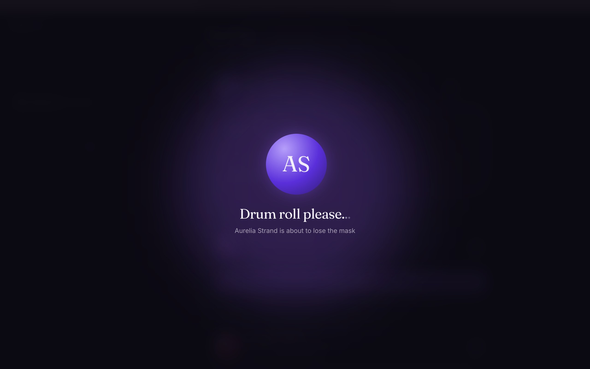<br/><sub><b>Drum roll please…</b></sub></td>
<td width="50%">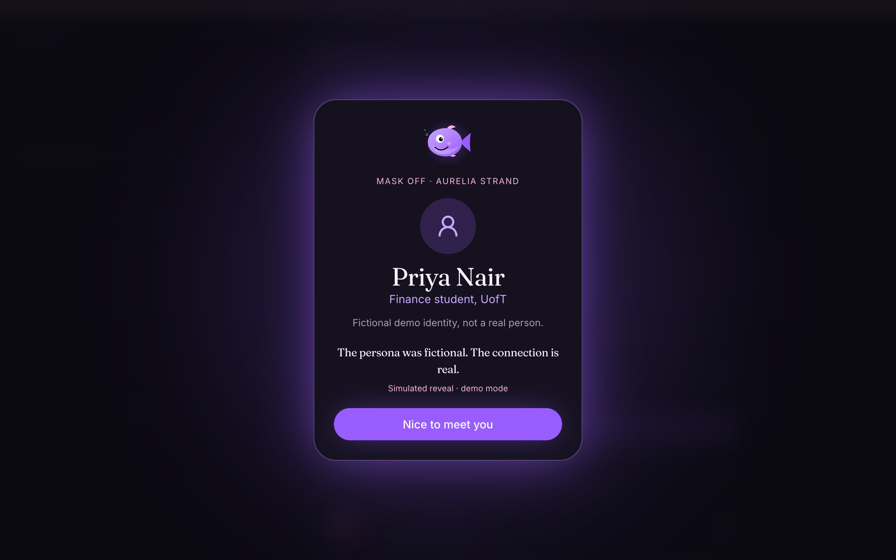<br/><sub><b>Mask off.</b> Only after both people consent.</sub></td>
</tr>
</table>

<div align="center">
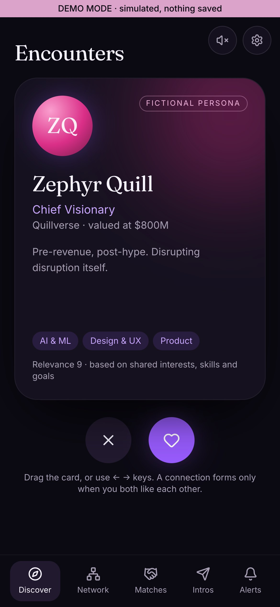&nbsp;&nbsp;
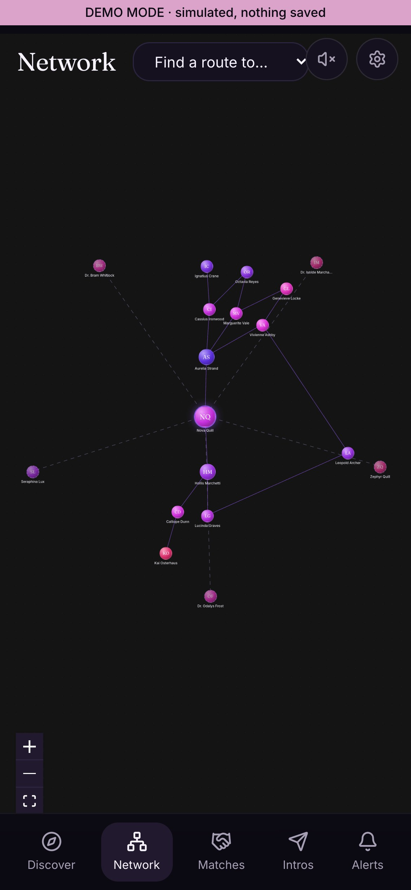
<br/><sub>Mobile layouts</sub>
</div>

<br/>


## Try it in 10 seconds

1. Open **[fishnet-0crx.onrender.com](https://fishnet-0crx.onrender.com)** and click **Try the demo**. No signup.
2. Press **→** on the first card. The first like always matches in demo mode.
3. Open **Network**, pick a far target, and press **Start quest**.
4. Open **Matches**, press **Reveal myself**, and turn **Sound on** for the drum roll.

> Demo mode is a clearly labelled simulation with 24 fictional people. It never touches the production database. The live app (real accounts, real persistence) is behind **Join FishNet**.

## How it works

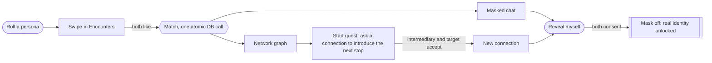

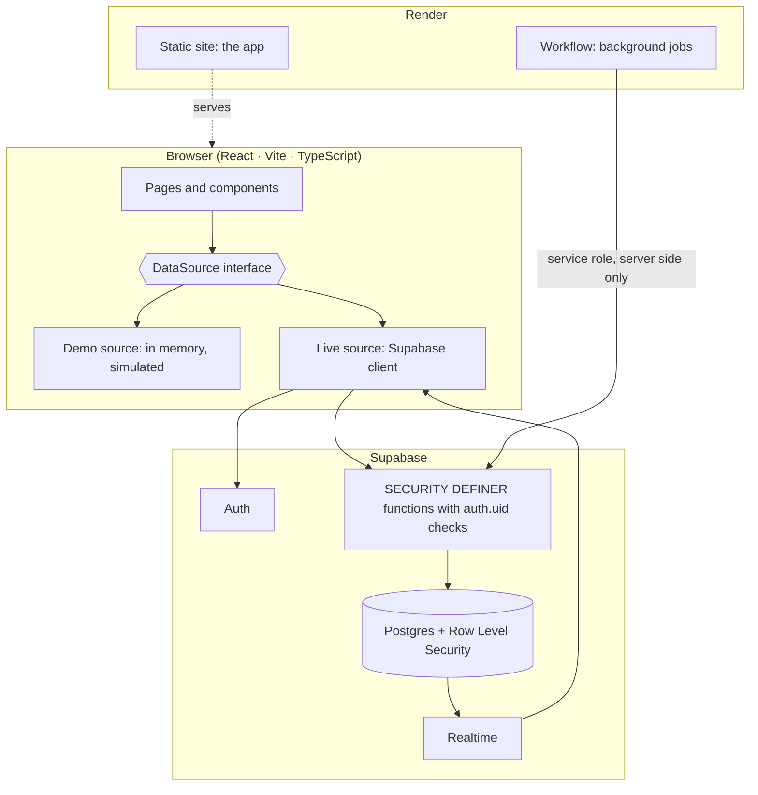

The UI is written once against a `DataSource` interface. **Demo** and **Live** are two implementations, so the demo exercises the same screens and the same graph algorithms as production.

<details>
<summary><b>🔒 Privacy and security model</b></summary>

<br/>

- **Real identity lives in its own table** (`private_identity`) that only its owner can read. Nobody else can `select` it, ever.
- **Reveal needs two consent rows.** `get_connections()` only returns a person's real name, role, bio and LinkedIn when *both* people have consented. Either person can withdraw, and access ends immediately.
- **Every cross-user read and write goes through a `SECURITY DEFINER` function** that checks `auth.uid()`, with a pinned `search_path`.
- **Matching is atomic.** A per-pair advisory lock plus a unique ordered pair means exactly one connection, even with simultaneous swipes.
- **Introductions need two approvals** (the intermediary, then the target). A completed introduction creates the connection.
- **Chat is private** to the two matched users by row-level security, with a per-minute rate limit.
- **No secrets in the browser.** The frontend uses only the public key. The service-role key exists only on the Render Workflow service.
- Row-level security is enabled on every exposed table.

</details>

<details>
<summary><b>🧮 How the relevance score works</b></summary>

<br/>

A transparent, deterministic weighted overlap. No AI, and the same people always get the same score.

| Overlap | Points per shared tag |
|---|---|
| Your interests ∩ their interests | **3** |
| Your skills ∩ their interests | **2** |
| Your interests ∩ their skills | **2** |
| Your goals ∩ their goals | **1** |

Tags are merged through a canonical taxonomy before saving, so `ML`, `machine learning`, `LLM` and `AI` all become **AI & ML**, and `fintech` and `finance` become **Fintech & Finance**. Optional **party codes** limit Encounters to people with the same code, for an event or community.

</details>

<details>
<summary><b>⚙️ Background jobs on Render Workflows</b></summary>

<br/>

**Where things run:** the app is a Render static site. The real matching (`discover_page`, `swipe`) runs inside Supabase Postgres. A Render Workflow (`workflows/`, service `fishnet-jobs`) runs background work off the request path, with automatic retries:

- **`refreshSuggestions`** fans out one `suggestForUser` subtask per discoverable user, 25 at a time in parallel. Each asks the database to score that user's candidates and write a "people match your interests" alert.
- **`expireStaleIntros`** closes introduction requests nobody answered within 7 days and tells the requester.
- **`runNightlyJobs`** runs both.
- **`loadTestMatching(shards, usersPerShard)`** is a load test of the scoring formula: it fans out parallel `scoreShard` tasks, each scoring every pair among synthetic profiles with the same weights as the real matcher. Synthetic data only, never real users. A deployed run of `[100, 1000]` (about 50 million pairs) succeeded in 1 min 23 s for about $0.0002; Render queues tasks beyond its concurrency limit.

The job functions are executable only by the database's service role, and the service-role key lives only on the Workflow service. See [WORKFLOWS.md](WORKFLOWS.md).

</details>

<details>
<summary><b>🎛️ Sound design</b></summary>

<br/>

Off by default, opt-in, and synthesized live with WebAudio (no audio files). Every button press is a soft **mechanical-keyboard clack**, typing in a field clicks like keys, swipes whoosh, a match is a shimmering arpeggio, and the reveal is an accelerating drum roll that lands on bell dings. It respects `prefers-reduced-motion` and never autoplays.

</details>


## Feature status

✅ verified end to end · 🟡 built, partly verified · ⛔ not done

| Feature | Status | How it was checked |
|---|---|---|
| Sign up, log in, session restore | ✅ | Live on Render with real accounts |
| Persona generator, re-roll, templates | ✅ | Browser, demo and live |
| Swipe deck (drag, keys, buttons, pagination, empty and error states) | 🟡 | Keyboard and clicks verified; touch drag not tried on a real phone |
| Mutual match, atomic, exactly one connection | ✅ | SQL tests plus live |
| Network graph, shortest route (BFS), quest walk | ✅ | Live, with a real 2-hop route |
| Introductions (intermediary then target) creating a connection | ✅ | SQL tests plus live end to end |
| Reveal (both consent, withdraw revokes) with drum roll | ✅ | SQL tests plus live |
| Masked chat and conversation starters | ✅ | Live between two accounts |
| Tappable alerts that route to the right page | 🟡 | Demo verified; live not re-tested |
| Tag taxonomy and tag picker | ✅ | 13 unit tests plus browser |
| Party codes and Settings | 🟡 | SQL-tested; saving verified live; two-account filtering not yet |
| Render static site | ✅ | https://fishnet-0crx.onrender.com |
| Render Workflow (suggestions, expiry, parallel load test) | ✅ | Deployed; `runNightlyJobs` and `loadTestMatching [100, 1000]` both succeeded |
| Sound | 🟡 | Runs without errors; not heard by the author |
| Realtime subscriptions | 🟡 | Wired; polling fallback in place |

**Known limits.** Built on free tiers, so no capacity claims. Discovery scores candidates in SQL per request, fine for thousands of users and not millions. Graphs show up to 3 hops, capped per ring. Needs moderation (report and block) before a public launch.

## Run it yourself

```bash
git clone https://github.com/Aarav0Maz/FishNet.git && cd FishNet
npm install
cp .env.example .env     # add your Supabase URL and anon key (demo mode works without)
npm run dev
```

```bash
npm test                 # unit tests and database tests (real SQL, in-process Postgres)
npm run build            # typecheck and production build
```

To run the live app, create a Supabase project and apply `supabase/migrations/0001` through `0006` in order, then follow [DEPLOYMENT.md](DEPLOYMENT.md) for Render.

<details>
<summary><b>📁 Project map</b></summary>

<br/>

```
src/
  pages/            Landing, Auth, Onboarding, Discover (Encounters), Network (Quest map), Matches, Chat, Intros, Inbox, Settings
  components/       SwipeDeck pieces, GraphCanvas, PathWalk, RevealCelebration, TagPicker, Mascot, ...
  data/             demo.ts (simulated world), supabase.ts (live), demoSeed.ts
  lib/              graph.ts (BFS and score), tags.ts (taxonomy), starters.ts, sound.ts, persona.ts
supabase/migrations/ schema, RLS, functions, chat, party, jobs
workflows/          Render Workflow tasks
docs/               banner, screenshots
```

</details>

## Docs

[DEMO_GUIDE.md](DEMO_GUIDE.md) · [DEMO.md](DEMO.md) · [DEPLOYMENT.md](DEPLOYMENT.md) · [WORKFLOWS.md](WORKFLOWS.md)

<div align="center">


Built solo for **LarpHacks 2026**, on **Render** and **Supabase**.

*Come for the fake status. Leave with real connections.*

</div>
